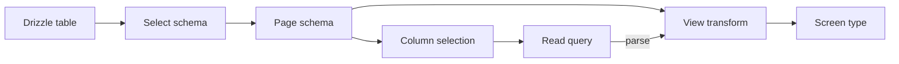
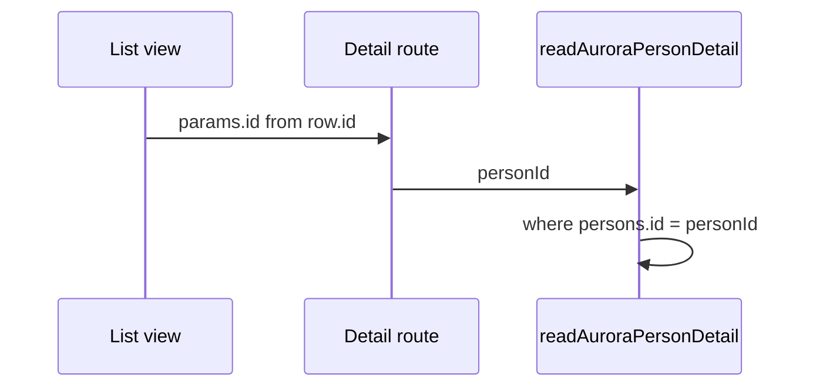

# Aurora person types and schemas

Aurora person reads pass through four shapes. Each shape has one job, and the next shape is derived from the one before it.

| Shape | Where it lives | What it is |
| --- | --- | --- |
| Table | `packages/aurora/src/person-schema.ts` | Drizzle columns stored in the stage database. |
| Select schema | same file, `createSelectSchema(table)` | Zod schema of one full row. An empty column is `null`. |
| Page schema | same file, `selectSchema.pick(...)` | The columns one read is allowed to return. |
| View | `apps/webapp/src/aurora-persons/view.ts` | Page schema plus `.transform()`. This is the type the screen uses. |



## Page schemas

A page schema is a pick of the select schema. The pick is the field list for that read.

| Page schema | Read | Columns |
| --- | --- | --- |
| `personListSchema` | Person list | `id`, `firstName`, `lastName`, `gender` |
| `personDetailSchema` | One person | `id`, `firstName`, `lastName`, `gender`, `dateOfBirth` |
| `addressPageSchema` | Addresses for that person | address columns, including `personId` |
| `bankAccountPageSchema` | Bank accounts for that person | bank-account columns, including `personId` |
| `contactPageSchema` | Contacts for that person | contact columns, including `personId` |
| `employmentPageSchema` | Employments for that person | employment columns, including `personId` |

`createdAt` and `updatedAt` stay on the persons table and the select schema. No page schema picks them, so no read returns them.

## Column selection

`apps/webapp/src/aurora-persons/aurora-persons.ts` builds the `SELECT` list beside the page schema:

```ts
type PageColumnSelection<TSchema extends z.ZodType> = {
  [K in keyof z.infer<TSchema>]: unknown;
};

const personListColumns = {
  id: persons.id,
  firstName: persons.firstName,
  lastName: persons.lastName,
  gender: persons.gender,
} satisfies PageColumnSelection<typeof personListSchema>;
```

`satisfies` checks the keys. Every page-schema field is present, and the object has no extra key. The value type is `unknown`, so the check does not prove that `gender` points at `persons.gender`. Keep the key and the column on the same name.

`readAuroraPersonList` selects `personListColumns`. `readAuroraPersonDetail` selects `personDetailColumns` and the four related column lists. Related rows are filtered with `personId`.

## View

A view is the page schema after `.transform()`. `parse` checks the query row, then runs the transform. The screen type is the transform output:

```ts
export type AuroraPersonListRow = z.output<typeof auroraPersonListView>;
```

`getAuroraPersonList` and `getAuroraPersonDetail` map each row through the matching view before the route sees it. Components take `AuroraPersonListRow`, `AuroraPersonDetail`, and the related row types. They do not take the page schema.

The transform is where a field can look different on the screen. `absent` turns a database `null` into `undefined` on the detail person, bank account, and employment views. The list view currently passes `gender` through, so a missing gender stays `null` on `AuroraPersonListRow` and becomes `undefined` on `AuroraPersonDetail`.

A display field can be derived in the same transform, for example a single `name` from `firstName` and `lastName`. That derived field exists only on the view.

## Link from the list to the detail query

The list row keeps `id` as stored. The table link sends that value as the route param. The detail route passes the param to the server function as `personId`. The detail query filters `persons.id` with that value, and the related queries filter `personId` with the same value.



The lookup value and the display value are different fields when the screen should show something else. `id` stays on the list row for the link. The transform may add or rewrite the fields the table renders. A value that exists only after the transform cannot be the query key, because the transform runs on the rows that already came back.

## Adding a field

1. Add the column on the Drizzle table when it is new storage, then generate a migration. See [Stage database lifecycle and migrations](./stage-database.md).
2. Pick the field on each page schema that should return it.
3. Add the same key to that read's column selection. `satisfies` fails until the keys match.
4. Map the field in the view transform. Use `absent` when the screen should see `undefined` for an empty column.
5. To open the detail query with a stored field other than `id`, keep that stored value on the list row and pass it into the server function and the `where` clause.

Writes use their own Zod objects in `apps/webapp/src/aurora-persons/server.ts` (`personFields`, `addressFields`, and the other input objects). Those inputs are not picked from the page schemas.

## Where the rules live

| Rule | Module |
| --- | --- |
| Tables, select schemas, page schemas | `packages/aurora/src/person-schema.ts` |
| Column selections and reads | `apps/webapp/src/aurora-persons/aurora-persons.ts` |
| View transforms and screen types | `apps/webapp/src/aurora-persons/view.ts` |
| `parse` on the way to the route | `apps/webapp/src/aurora-persons/server.ts` |
| List link sending `id` | `apps/webapp/src/aurora-persons/table.tsx` |
| Detail route passing `personId` | `apps/webapp/src/routes/demo/db-persons.aurora_.$id.tsx` |
