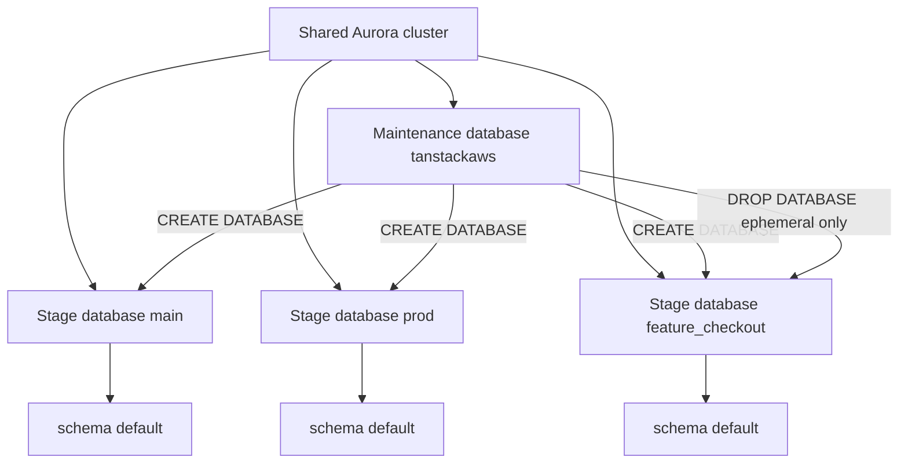
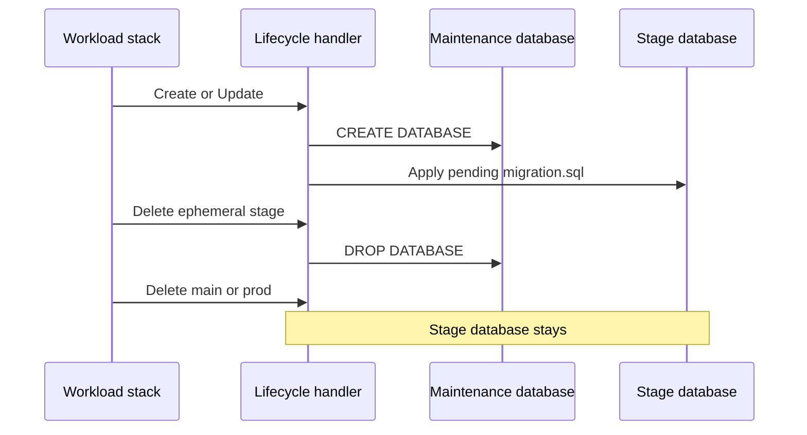
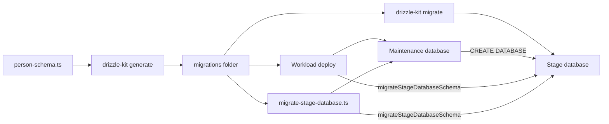

# Stage database lifecycle and migrations

Each workload stage has its own **stage database** on the shared Aurora cluster. `main` and `prod` are permanent stages. Every other stage is ephemeral. The database name comes from the stage: `main`, `prod`, or `feature_checkout`.

Person tables live in schema `default` inside that database. The schema is never named after the stage, so the `main` stage database and schema `default` are different identifiers.

The cluster is Data API only. Account setup owns it and publishes the connection in SSM. See [Account setup](../apps/cdk-account-setup/README.md). The decision to use a database per stage is [ADR-0002](./adr/0002-stage-databases-on-shared-aurora.md).

## Maintenance database

The **maintenance database** is `tanstackaws`. It does not hold person tables. Create and drop of a stage database run there as their own auto-commit Data API calls. SSM parameter `/tanstack-aws/shared/aurora/database-name` stores the name.

## Deploy

`SharedWorkloadData` in the workload stack registers a custom resource, `AuroraSchemaLifecycle`. The handler is `src/lambda/aurora-schema-lifecycle.ts`. The bundle includes `packages/aurora/migrations`.

| Custom resource event    | What the lifecycle does                                                                                                                          |
| ------------------------ | ------------------------------------------------------------------------------------------------------------------------------------------------ |
| Create or Update         | `CREATE DATABASE` on the maintenance database, then apply pending migrations to the stage database. An existing stage database is left in place. |
| Delete, ephemeral stage  | `DROP DATABASE` for that stage database.                                                                                                         |
| Delete, `main` or `prod` | Leave the stage database in place.                                                                                                               |

`migrationsHash` is a hash of every `migration.sql` in `packages/aurora/migrations`. A new or edited migration changes the custom resource, so the next deploy runs the handler again. Snapshot-only edits do not.

The handler retries a call when Aurora reports `resuming after being auto-paused`: four retries, 30 seconds apart. The same function, `withAuroraResumeRetry`, covers the local create-and-migrate command below. Any other error fails immediately.

## Migrations

`packages/aurora/src/person-schema.ts` is the schema source. How those tables become page schemas, query columns, and screen types is [Aurora person types and schemas](./aurora-person-types.md). Drizzle Kit writes one folder per migration under `packages/aurora/migrations/`, each with `migration.sql` and `snapshot.json`. There is no `meta/_journal.json`.

Deploy applies those files with the Drizzle RDS Data API migrator (`migrateStageDatabaseSchema`) after the stage database exists.

These tasks read the deployed workload stack. Set `APP_STAGE` to select a stack other than the one for the current git branch. `APP_STAGE=prod` selects the prod stage database. A branch named `prod` does not. Branch `main` selects the `main` stage database.

| Task     | Command                       | Effect                                                                                                                   |
| -------- | ----------------------------- | ------------------------------------------------------------------------------------------------------------------------ |
| Generate | `vp run drizzle-kit:generate` | Write a new migration folder from the person schema.                                                                     |
| Migrate  | `vp run drizzle-kit:migrate`  | Apply pending SQL with Drizzle Kit. The stage database must already exist.                                               |
| Studio   | `vp run drizzle-kit:studio`   | Open Drizzle Studio against the stage database.                                                                          |
| Seed     | `vp run db-aurora:seed`       | Insert 100 persons with addresses, contacts, bank accounts, and employments. Existing rows with those ids stay in place. |

`vp exec tsx packages/aurora/src/cli/migrate-stage-database.ts` follows the deploy path for a Create: it creates the stage database when it is missing, then applies migrations with `migrateStageDatabaseSchema`. It never drops a database. The workload stack must already be deployed, because the command reads that stack's Aurora outputs.

## Where the rules live

| Rule                                                                                | Module                                                  |
| ----------------------------------------------------------------------------------- | ------------------------------------------------------- |
| Stage database name and schema `default`                                            | `packages/aurora/src/stage-database-name.ts`            |
| Create, drop, and the refusal to treat the maintenance database as a stage database | `packages/aurora/src/stage-database-lifecycle.ts`       |
| Apply migration SQL                                                                 | `packages/aurora/src/stage-database-drizzle-migrate.ts` |
| Deploy custom resource and migration hash                                           | `apps/cdk-app/lib/constructs/AuroraSchemaLifecycle.ts`  |
| Auto-pause retry                                                                    | `packages/aurora/src/aurora-resume.ts`                  |
